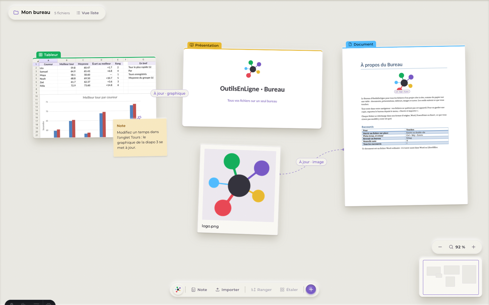
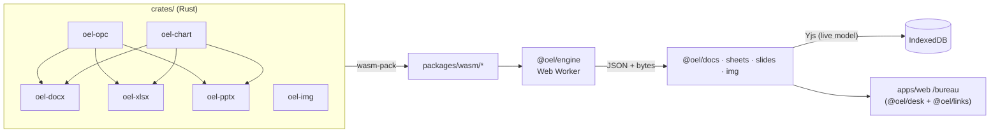

<div align="center">


# Bureau · OutilsEnLigne

**Every file of a project on one desk — documents, spreadsheets, presentations and images — edited in the browser,
with Word, Excel and PowerPoint files kept intact.**

[](LICENSE)




</div>

The Bureau lays the files of a project side by side, like paper on a table. Double-click a paper to open it in
place; the tools follow what you touch. A chart can be linked into a slide and a picture into a document, and the
copies follow their source. Everything runs in the browser: the file formats are handled by Rust engines compiled to
WebAssembly, and in this release your files never leave your device.

Made in Québec for students, from high school to university. The interface is in French (fr-CA) or English (asked on the
first visit, changed in « Paramètres »); the site and the documentation are in French and English.

## Highlights

- **Lossless Office round trips.** `.docx`, `.xlsx` and `.pptx` go through codecs that rewrite only what you changed;
  untouched parts, styles, themes, charts and anything not modelled yet (fields, SmartArt, animations…) come back as
  they were.
- **Real editors.** A Word-like document editor (styles, lists, tables, footnotes, headers, pagination), an
  Excel-compatible spreadsheet (IronCalc: `XLOOKUP`, `MINIFS`, `RANK.EQ`…, charts), a PowerPoint editor (layouts,
  shapes, notes, presenter view), and a non-destructive image workshop (wgpu: WebGPU → WebGL2 → CPU).
- **Linked copies (« fils de liaison »).** Put a chart, a range or an image in a slide or a document; it stays up to
  date (live, manual or frozen), and a thread on the desk shows where it comes from.
- **Accessible desk.** A DOM canvas that is a real listbox: every gesture has a key, moves are announced, a list view
  is always one click away. Built on react-aria.
- **Private by default.** The single-user release keeps the desk and every file in IndexedDB, with a lossless
  « Exporter le bureau (.zip) » backup.

## Try it

You need **Node 24** (`.nvmrc`) and **Rust** through rustup, which installs the version pinned in
`rust-toolchain.toml` with its `wasm32-unknown-unknown` target (a distribution's Rust works too if it is recent and
has that target); `wasm-pack` comes from npm.

```bash
rustup toolchain install   # the pinned Rust, from rust-toolchain.toml
npm install
npm run dev        # http://localhost:4321 — the site, /bureau (the editor), /docs
```

`npm run dev` builds the Rust engines to WebAssembly first when they are stale. Then open
<http://localhost:4321/bureau>: a new desk holds a demo (a lap-times spreadsheet, a welcome deck whose chart is linked
to it, a logo and a document).

| Command | What it does |
|---|---|
| `npm run dev` | Single-user Bureau + site (no server) |
| `npm run dev:equipe` | Team edition: web + collaboration server on :8787 |
| `npm test` | `cargo test --workspace`, then every vitest suite |
| `npm run typecheck` | Regenerates the Rust → TS contract types, then `tsc` per package |
| `npm run build` | Static site in `apps/web/dist` (`PUBLIC_EDITION=equipe npm run build` for the team build) |
| `npm run build:wasm` | Rebuilds every crate's WASM (web + Node targets) into `packages/wasm/` |
| `bash scripts/build-site.sh` | Hosting build: installs Rust if missing, browser WASM only, then the site (DigitalOcean: `.do/site.Dockerfile` + `.do/app.yaml`) |

## Editions

One switch, `PUBLIC_EDITION` (`apps/web/src/edition.ts`), decides what the front end shows. Packages never read it;
the app passes flags down as props.

| | `solo` (default, this release) | `equipe` (built, not shipped yet) |
|---|---|---|
| Storage | Desk and files in this browser (IndexedDB), `.zip` backup | Plus the collaboration server (`apps/collab`) |
| Sharing, presence, version history | Hidden | Share links with roles, live avatars, named and automatic versions |
| Forms | Hidden | Builder, linked response spreadsheet, public respondent page (local stub backend) |
| Projects and members | One desk, « Mon bureau » | Projects, four roles, settings cascade (local stub backend) |

## Repository map

```
crates/                 Rust workspace — file formats and computation only (no UI)
  oel-opc/              lossless XML DOM + OPC package (zip, rels, content types)
  oel-docx/             .docx ⇄ ProseMirror JSON
  oel-xlsx/             .xlsx / .csv ⇄ workbook JSON, IronCalc calculation
  oel-pptx/             .pptx ⇄ deck JSON
  oel-chart/            DrawingML charts ⇄ ChartSpec, shared by the three codecs
  oel-img/              non-destructive image pipeline (CPU reference + wgpu)
packages/               TypeScript, shipped as source and compiled by the app
  engine/   @oel/engine     file detection, engine contract, Web Worker host, WASM adapters, generated types
  emboss/   @oel/emboss     blind-emboss UI kit on react-aria-components, Figma tokens (light/dark)
  desk/     @oel/desk       accessible infinite desk: framework-free core + React DOM renderer
  docs/     @oel/docs       document editor (Tiptap/ProseMirror + Yjs)
  sheets/   @oel/sheets     spreadsheet editor (canvas grid, IronCalc in a worker)
  slides/   @oel/slides     presentation editor, slideshow, presenter view
  charts/   @oel/charts     Office chart renderer (every chart type) and chart UI
  img/      @oel/img        image engine host, recipes, originals by content hash
  links/    @oel/links      linked copies: model, states, desk threads
  fonts/    @oel/fonts      fonts of opened files, open substitutes (Fontsource, OFL)
  collab-client/            Yjs session base, offline storage, sync / share / version UI
  forms/    @oel/forms      forms builder and respondent page (team edition)
apps/
  web/      @oel/web        Astro site: home, /docs (fr + en), /bureau (the editor)
  collab/   @oel/collab     collaboration server: Hocuspocus (Yjs), share links, versions, exports (team edition)
fixtures/               shared test corpus (docx, xlsx, pptx, charts, images, the demo Bureau)
docs/                   plans (docs/plans/) and package details (docs/packages.md)
```

## How it fits together



Files are import/export; the live model of every open file is a Yjs document, saved on the device (and synced to
the server in the team edition). The editor shell never parses a file: it asks the engine worker. Layer rules and the
reasoning are in [`ARCHITECTURE.md`](ARCHITECTURE.md); each package in detail in
[`docs/packages.md`](docs/packages.md).

## The Rust crates

The most reusable part of the project: lossless OOXML in Rust is rare. Each crate builds natively and, with its
`wasm` feature, for the browser and Node.

| Crate | Library | What it does |
|---|---|---|
| `oel-opc` | `oel_opc` | XML DOM that keeps what it doesn't understand, OPC packages (parts, relationships, content types) |
| `oel-docx` | `oeldocx` | `.docx` → editor JSON → `.docx`, rewriting only what changed |
| `oel-xlsx` | `oelxlsx` | `.xlsx` and `.csv` ⇄ workbook JSON, formulas computed with IronCalc |
| `oel-pptx` | `oelpptx` | `.pptx` ⇄ deck JSON (layouts, themes, DrawingML) |
| `oel-chart` | `oelchart` | every Office chart type read to a `ChartSpec`, charts written back |
| `oel-img` | `oelimg` | recipe-based image retouching, CPU reference and wgpu (parity-tested) |

```bash
cargo test --workspace
cargo run -p oel-xlsx --example recalc -- in.xlsx out.xlsx   # compute formulas and chart caches of any workbook
```

## Status

Working, in French and English: the desk (selection, zoom, notes, galleries, list view, saved on the device, `.zip`
backup), documents, spreadsheets with charts, presentations with slideshow and presenter view, the image workshop,
linked copies (charts, ranges, images) written into exports. Not yet: PDF viewing and annotation (a PDF keeps its page
count only), editing charts inside slides and documents, animations and SmartArt (kept, not editable).
The full table is in [`docs/packages.md`](docs/packages.md#whats-real-and-whats-stubbed); what users see is in the
site's documentation (`/docs`, `/en/docs`).

**Next:** the team edition on a Canadian-hosted server (accounts, sharing, forms backend — planned in
`docs/plans/2026-10-backend-mvp.md` on the `feat/backend` branch), a mobile layout, the PDF engine, a desktop app (Tauri).

## For AI agents

Start with [`AGENTS.md`](AGENTS.md): commands, conventions, the edition switch and where things live. Task-specific
guides are in `.claude/skills/oel-*/SKILL.md` (plain Markdown, usable by any agent): `oel-architecture` first, then
`oel-rust-engine`, `oel-file-kind`, `oel-editor-feature`, `oel-charts` or `oel-collab-backend`, and `oel-verify` to
finish. Plans with their status live in `docs/plans/`.

## Contributing, security, licence

- How to contribute: [`CONTRIBUTING.md`](CONTRIBUTING.md). Reporting a vulnerability: [`SECURITY.md`](SECURITY.md).
- Licensed under the [Mozilla Public License 2.0](LICENSE): use the crates and packages in your own projects; changes
  to these files stay open.
- Third-party code, fonts and icons: [`THIRD_PARTY.md`](THIRD_PARTY.md).
